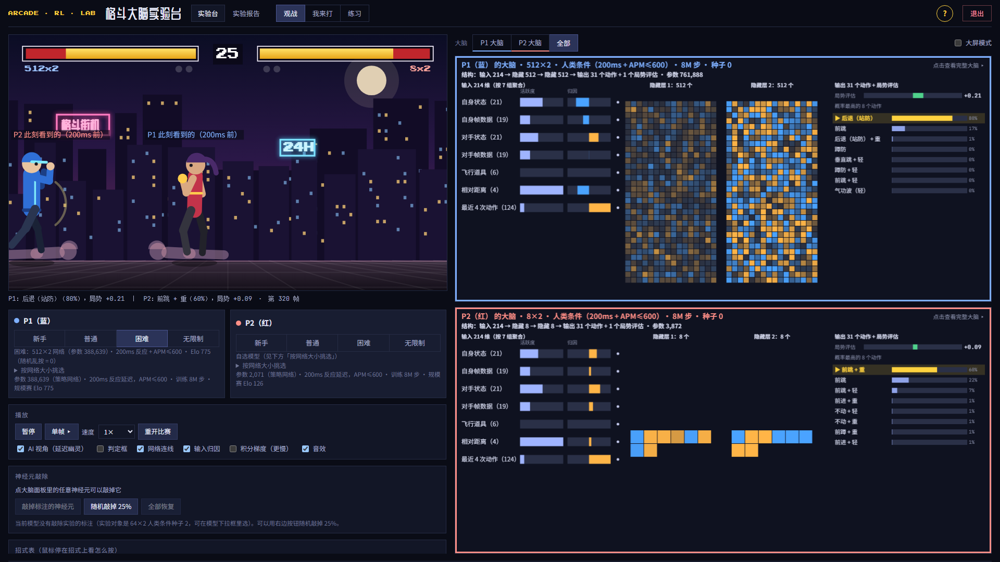

> **AI 教学演示案例 / AI Teaching Demos** 系列

# 格斗大脑实验台：看得见神经网络的街机格斗强化学习

**Shuyao Gao** · aSSIST University (Seoul School of Integrated Sciences and Technologies) · 서울과학종합대학원대학교
代码 MIT · 文档与教学素材 CC BY 4.0

一台自带的 60 帧 2D 街机格斗小游戏，加上用强化学习（PPO + 自博弈联赛）训练出来的 AI 对手。打开网页就能和 AI 对打，或者看两个 AI 互打；屏幕另一侧实时显示 AI 神经网络的输入、隐藏层激活、动作概率和局势评估，可以换不同大小的网络、点神经元把它「敲掉」。仓库里还有完整的训练框架和一组可复现的实验：网络大小、反应延迟、手速上限、利用者、神经元敲除。适合机器学习、深度学习、强化学习、前端可视化等课程拿来做课堂演示。

**English summary.** *Fighting Brain Lab* is a browser-based teaching demo of reinforcement learning in a small 60-fps 2D arcade fighting game. Pre-trained PPO self-play agents run directly in the browser (pure JavaScript, no install, works offline from `file://`), and a live panel shows each agent's neural network: real input features, hidden activations, action probabilities, value estimate and gradient-based attributions; you can swap network sizes and knock out neurons. The repository also contains the full Python training framework (environment, human-like reaction-delay and APM constraints, self-play league, exploiters, Elo evaluation) and reproducible experiments on network scaling, reaction delay, action-rate limits, exploitability and neuron knockout. UI and documentation are in Chinese.



## 只想玩：不用安装任何东西

三种方式任选一种：

- **在线试玩**：<https://ShuyaoGao.github.io/fighting-brain-lab/play/>（GitHub Pages，打开就能玩）。
- **下载发布包**：在本仓库右侧 **Releases** 里下载 `格斗大脑实验台-v1.0.zip`（约 8 MB，只含游戏本体），解压后双击文件夹里的 `index.html`（或「开始游戏.html」）。
- **下载整个仓库**：点 **Code → Download ZIP**，解压后双击 **`play/index.html`**。

不需要 Python，不需要联网；模型、字体、录像都在 `play/assets/` 里。

| 玩法 | 怎么用 |
|---|---|
| 观战（打开即是） | 两个神经网络对打：左边是游戏，右栏是它们的「大脑」（「P1 大脑 / P2 大脑 / 全部」切换，可开「大屏模式」） |
| 我来打 | 点顶部的「我来打」。对手四档：新手 / 普通 / 困难 / 无限制，旁边写明网络大小和 Elo |
| 练习 | 对手是木桩，右侧任务清单逐项打勾：前进、后退、跳、蹲、站防、蹲防、轻攻击、重攻击、气功波、冲天拳 |

键位：<kbd>A</kbd>/<kbd>D</kbd> 移动，<kbd>W</kbd> 跳，<kbd>S</kbd> 蹲，按住「后」= 防御，<kbd>J</kbd> 轻攻击，<kbd>K</kbd> 重攻击。
**新手模式**（默认开）：<kbd>U</kbd> 气功波、<kbd>I</kbd> 冲天拳，按住 <kbd>Shift</kbd> 放重版本。AI 的动作空间里本来就有这 4 个「搓招宏」，每一下方向和按键照样计入手速，所以给人类一键搓招是公平的。
第一次打开会弹出操作说明，之后按 <kbd>H</kbd> 或右上角「?」随时再看。招式表里鼠标停在招式上，会按顺序点亮要按的方向键；画面左侧有输入历史，搓招没出来时会提示差在哪。

已测试：Windows 上的 Chrome 和 Edge，1920×1080 与 1366×768 两种分辨率，23 项检查全部通过（`python -m arena.browser_check`）。Firefox 未测；Safari 未测，需要在真实 Mac 上确认。

## 为什么打开就能对战：模型是事先训练好的

网页里的 AI 都是**事先在一台性能较强的机器上训练好**（一台 24 线程 CPU、RTX 5090 Laptop GPU 的笔记本；小网络用 CPU 训练，大网络用 GPU），再把权重导出成 float16 放进 `play/assets/gen/models/`。浏览器只做推理（纯 JavaScript），所以同学打开就能直接对战，不需要再训练。

| | 数字（来自各 run 的 `result.json`） |
|---|---|
| 每个对战模型的训练量 | 自博弈联赛 8M 智能体步（约 3200 万帧，相当于约 148 小时的游戏时间） |
| 每个模型的训练用时 | 24–27 分钟（多个模型并行训练时的实测墙钟时间） |
| 全部实验 | 101 次训练，共 5.62 亿智能体步，单次用时累加约 24.4 小时（实际并行跑完，规模实验约 4 小时） |
| 发布包里的模型 | 13 个（人类条件 7 种宽度 + 敲除实验对象 + 无限制 3 个 + 早期实验 2 个），全部 float16，`play/` 合计约 10 MB |

`runs/`（checkpoint 和原始日志）没有放进仓库；想复现见下面「想自己训练」。

## 课堂上怎么用（5 分钟）

**观战 → 看大脑 → 换网络大小 → 敲神经元 → 请同学上手**。逐步讲稿见 [docs/DEMO.md](docs/DEMO.md)，界面上每个元素的含义见 [docs/ARENA.md](docs/ARENA.md)。

- **看大脑**：左列是网络看到的 90 个输入（真实特征名）；AI 有 200ms 反应延迟，所以条形显示的是它「看到的旧值」，白线是此刻真实值，画面里的半透明人影就是它看到的世界。中间是隐藏层（橙正蓝负），右列是 31 个动作的概率和局势评估。底部的归因（梯度 × 输入）是相关性解释，不是因果。
- **换网络大小**：P2 面板「按网络大小挑选」里拖宽度滑块（8 → 512）。大脑顶部的结构式（如「输入 214 → 隐藏 512 → 隐藏 512 → 输出 31 个动作 + 1 个局势评估」）会跟着变。
- **敲神经元**：点任意神经元把它置零；或一键「随机敲掉 25%」，再「全部恢复」。

## 实验结论摘要

所有数字都在 `results/*/result.json`，网页「实验报告」标签页有交互图表。逐局原始记录（每局胜负的 CSV）体积较大，没有放进仓库；需要时可以用 `scripts/tournament.py`（或 `experiments/scaling/analyze.py tournament`）在本地训练好模型后重新生成。

- **网络越大越强，但主要是一跳**：在人类条件（200ms 反应 + 每分钟最多 600 次操作）下，宽度 8 → 512 的 Elo 均值 −92 → 733（随机乱按 = 0；种子级 Spearman ρ = 0.80，n = 21）；128 → 256 之间跳了约 460 分，8～128 之间各组区间大面积重叠。512 宽对 8 宽直接对战平均得分 98%。
- **人类条件比网络大小更要紧**：不受约束（0ms、不限手速）的 16 宽网络（约 4 千参数）对人类条件下 512 宽网络（约 39 万参数）得分 81%。早期实验里，限手速（APM ≤ 300/600）让 Elo 从约 1500 掉到 241/441，而 200ms 反应延迟在同批模型之间看不出削弱。
- **循环赛强不等于打不穿**：同样受人类条件约束的「利用者」只针对一个模型训练 2M 步，7 个目标里 6 个被打到 50% 以上，包括最强的 256、512 宽。
- **没有单个「关键神经元」**：64×2 网络逐个敲掉 128 个神经元，最大下降 5.4%，复核后前 8 个只剩 −0.9%～2.4%；一起敲掉 32 个，按梯度重要度挑下降 29%，随机挑 26%。线性探针显示第一层能读出「对手在空中」（平衡准确率 0.995）等概念。都是相关性，不是因果。
- **能不能打过职业选手？** 在这台小街机里，人类级反应和手速条件下没有证据支持「RL 必然打得过职业选手」。要回答它，需要真实游戏、真人盲测，并且利用者打不穿。

局限：单角色简化游戏；每个配置 3 个种子；利用者每个宽度只做了 1 个；APM 上限没有真人基准。

## 常见问题

- **关掉网页后会不会还有进程在后台跑？** 不会。离线版（`play/` 或 zip）是纯静态网页，关掉标签页就全部结束，不会留下后台进程。右上角的「退出」会先停掉游戏循环、音效和手柄监听并释放模型数据。只有从源码用 `python -m arena` 启动时才有一个本地服务：点「退出」会关掉它；直接关标签页的话，它在 30 秒内收不到页面心跳也会自动退出。
- **双击 index.html 却用记事本打开了？** 右键 →「打开方式」→ 选浏览器。
- **键盘没反应？** 先切到「我来打」或「练习」，再点一下游戏画面让它获得焦点。
- **投影看不清大脑？** 打开右栏的「大屏模式」，或在右栏只看一个大脑。

## 目录结构与代码地图

交互式代码地图：[docs/code_map.html](docs/code_map.html)（下载后用浏览器打开；开启 GitHub Pages 后在线地址是 `https://ShuyaoGao.github.io/fighting-brain-lab/docs/code_map.html`）。

```
play/                免安装版（双击 index.html），由 python -m arena.build --release 生成
arena/               实验台：web/（页面与 JS：游戏核心、网络推理与解释、大脑面板、新手引导、渲染、音效、输入）、
                     export.py（导出权重）、build.py（本地页 / 免安装版）、fonts.py（字体子集）、capture.py / record.py / browser_check.py
envs/                环境：fighting2d/（自带 2D 格斗核心、观测说明、naming.json 招式名与外观）、真实游戏适配器（stable-retro / DIAMBRA）
wrappers/            人类条件包装器：跳帧、搓招宏、观测延迟、APM 上限、动作历史、像素观测
agents/              PPO、脚本 CPU、NumPy 推理策略
league/  eval/       对手池与 Elo、对局评估与录像
scripts/             训练、循环赛、实验清单、分析、人机对战（tkinter）
experiments/scaling/ 规模实验：作业清单、循环赛与出图、神经元敲除与线性探针
results/             进仓库的小结果：result.json、图、录像截图
tests/               74 个测试（含 JS 与 Python 逐帧对拍、浏览器无头测试）
docs/                ENV_SPEC（环境规格）、ARENA（实验台说明）、DEMO（课堂讲稿）、LANDSCAPE（格斗 RL 生态调研）、code_map
credits.json         署名与系列信息（tools/fill_credits.py 用它替换 {{KEY}} 占位）
```

## 想自己训练

作者在 Python 3.12（Windows）上开发和测试。

```bash
python -m venv .venv
# Windows: .venv\Scripts\activate    macOS / Linux: source .venv/bin/activate
pip install torch                     # 按显卡选版本：https://pytorch.org/get-started/locally/
pip install -r requirements.txt
python -m pytest tests -q             # 74 个测试；没有 Chrome/Edge 或 quickjs 时相关测试自动跳过

python scripts/train.py --mode league --steps 8000000 --hidden 128 --layers 2 --delay-ms 200 --apm 600 --out runs/my_first
python -m experiments.scaling.plan list            # 规模实验的全部作业
python -m experiments.scaling.plan run --parallel 4
python -m experiments.scaling.analyze tournament --games 100 --procs 8
python -m experiments.scaling.analyze report
python -m arena                       # 导出自己训练的模型，打开本地实验台
python -m arena.build --release       # 重新生成 play/ 和 release/*.zip
```

一个 8M 步的模型在 24 线程 CPU 上约 25 分钟（多个并行时）。训练细节见 [docs/ENV_SPEC.md](docs/ENV_SPEC.md)。

**真实街机游戏**：`envs/retro_adapter.py`、`envs/diambra_adapter.py` 和 `envs/game_specs/` 留好了接口，换游戏只换一份配置；需要 Linux 和**自己合法拥有的 ROM**。本仓库不包含、也不下载任何 ROM。生态调研见 [docs/LANDSCAPE.md](docs/LANDSCAPE.md)。

## 如何引用

见 [CITATION.cff](CITATION.cff)（GitHub 页面右侧「Cite this repository」可以直接导出）。

```bibtex
@software{gao_fighting_brain_lab_2026,
  author  = {Gao, Shuyao},
  title   = {格斗大脑实验台 / Fighting Brain Lab: a browser-based teaching demo of reinforcement learning in a 2D fighting game},
  year    = {2026},
  version = {1.0},
  url     = {https://github.com/ShuyaoGao/fighting-brain-lab}
}
```

## 许可证

- 代码：MIT License（[LICENSE](LICENSE)）。
- 文档与教学素材（README 正文、`docs/`、代码地图、实验台页面上的文字与图表、`results/` 里的图和录像）：CC BY 4.0（[LICENSE-docs](LICENSE-docs)）。转载、改编请署名。
- 第三方依赖与字体的许可证见 [THIRD_PARTY.md](THIRD_PARTY.md)。

## AI 辅助开发声明

代码由 Claude Code 辅助编写，经作者审阅。
